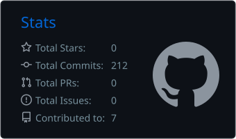
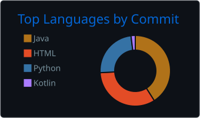

 

---

## 👋 Sobre mí

Soy **Software Engineer** en **Capgemini ADCenter**, en España .
Trabajo con **Java y Spring Boot** en backend, **Angular** en frontend y **Kotlin** en móvil (Android y Kotlin Multiplatform), dentro de equipos ágiles con Scrum.

- 💼 Software Engineer en Capgemini ADCenter desde octubre de 2026, donde antes hice las prácticas
- 🎓 Grado en Desarrollo de Aplicaciones Multiplataforma (Cesur Murcia Audio, 2024-2026)
- 🧠 Me interesan la arquitectura de software, las bases de datos y el código limpio
- 🌍 Idiomas: español e italiano (nativos), francés B2 (DELF) e inglés B1

---

## 🛠️ Tecnologías

  
  
  
  
  
  
  
  
  
  

---

## 📌 Proyectos destacados

| Proyecto | Descripción | Stack |
|---|---|---|
| [**ProyectoPokemon**](https://github.com/adrianoalbertii/ProyectoPokemon) | Aplicación de escritorio con interfaz gráfica y base de datos | Java · JavaFX · MySQL |
| [**GestorClubDeportivo**](https://github.com/adrianoalbertii/GestorClubDeportivo) | Gestión de un club deportivo con arquitectura cliente-servidor | Java · Sockets · Threads · DAO |
| [**CodeQuestTFG**](https://github.com/adrianoalbertii/CodeQuestTFG) | Plataforma educativa (Trabajo de Fin de Grado, en desarrollo) | Kotlin · Android |

---

## 📊 Estadísticas de GitHub

  
  

---

## ⚙️ Cómo trabajo

- 🧱 **Código limpio y mantenible**, con arquitectura por capas y patrones como DAO
- 🗄️ **Bases de datos bien modeladas**, con MySQL como herramienta habitual
- 🔌 **Backend en Java y Spring Boot**, y también aplicaciones cliente-servidor con sockets e hilos
- 🎨 **Frontend con Angular** para completar el ciclo de una aplicación
- 📱 **Móvil nativo y multiplataforma** con Kotlin, Android y Kotlin Multiplatform

---

## 🌐 Contacto

---

  

